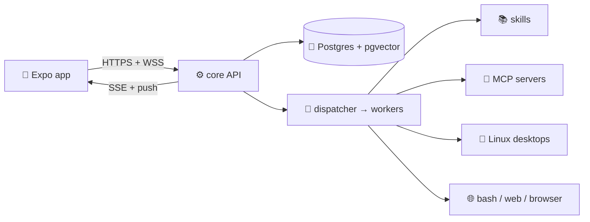

<div align="center">

# 🤖 Kuru

**Your own Grok-style bot — self-hosted, with almost every feature.**
Chat from your phone. Agents team up, run workers, remember, schedule routines, use skills & MCP tools, drive a real Linux desktop you can watch.

[](LICENSE)
[](https://nodejs.org)
[](https://pnpm.io)
[](https://www.docker.com)
[](https://expo.dev)
[](CONTRIBUTING.md)

[Install](#-install) · [Features](#-features) · [How it works](#-how-it-works) · [Setup guide](deploy/SETUP.md) · [Contributing](CONTRIBUTING.md)

</div>

> **Work in progress** — This repo is the public open-source home for Kuru. The project is under active development (pre-1.0): setup steps, APIs, and mobile UX can change between commits. Treat it as experimental self-hosting software, not a frozen production release; pin a commit or tag if you need stability. Issues and PRs are welcome.

<p align="center">
  
</p>

> **Bring your own API keys** — This project does not include model API keys. After you sign in, open **Account → Providers** in the app and add keys for OpenAI, Anthropic, xAI, or an OpenAI-compatible base URL (per account, stored encrypted in Postgres). **Google OAuth** is only for login. Optional `EXA_API_KEY` / `BRAVE_API_KEY` in `apps/core/.env` are for shared web search, not chat models.

---

## Table of contents

- [⚡ Install](#-install)
- [✨ Features](#-features)
- [🧠 How it works](#-how-it-works)
- [📱 Phone app](#-phone-app)
- [🖥️ Agent desktops](#️-agent-desktops)
- [🧩 Skills & MCP plugins](#-skills--mcp-plugins)
- [⏰ Routines & teams](#-routines--teams)
- [⚙️ Configuration](#️-configuration)
- [🔄 Updating](#-updating)
- [🧪 Develop](#-develop)
- [🤝 Contributing & Security](#-contributing--security)

---

## ⚡ Install

> Every step in detail — Google OAuth, the tunnel, building the phone app: [`deploy/SETUP.md`](deploy/SETUP.md)

There are two ways to run Kuru: on your own Linux machine with Docker, or from source for development. Both need a public HTTPS address (a Cloudflare Tunnel is the easy way) and a Google OAuth web client for sign-in.

### On your own Linux laptop or server (recommended)

The database, the core, and one Linux computer per account all run in Docker. A Cloudflare Tunnel makes it reachable from your phone anywhere, with no static IP and no open ports. Node.js is not needed. You need a domain on Cloudflare (free plan) and a Google OAuth client.

```bash
# Docker and the code
curl -fsSL https://get.docker.com | sh
git clone https://github.com/shoodoow/kuru.git && cd kuru

# The tunnel (after installing cloudflared)
cloudflared tunnel login
cloudflared tunnel create kuru
cloudflared tunnel route dns kuru api.example.com
# write ~/.cloudflared/config.yml: api.example.com -> http://127.0.0.1:3000

# Settings
cp -n apps/core/.env.example apps/core/.env
echo "POSTGRES_PASSWORD=$(openssl rand -hex 24)" >> .env
# apps/core/.env: BETTER_AUTH_SECRET (openssl rand -hex 32),
# BETTER_AUTH_URL=https://api.example.com, GOOGLE_CLIENT_ID,
# GOOGLE_CLIENT_SECRET, NODE_ENV=production

# Start
docker build -t kuru-linux:1 apps/core/linux          # the agents' computer image
docker compose --profile core up -d --build
curl -fsS http://127.0.0.1:3000/health                # {"ok":true}
sudo cloudflared --config ~/.cloudflared/config.yml service install
```

On the phone, tap the server address at the bottom of the welcome screen and enter yours under **Server**. Every step explained, with the Google sign-in setup: [Install on Linux with Docker and a tunnel](deploy/SETUP.md#install-on-linux-with-docker-and-a-tunnel).

### For development (laptop)

Need **Node.js ≥ 22.13**, **pnpm 12.6** (`packageManager` in the root `package.json`), and **Docker**. A phone also needs **Expo Go** and **cloudflared**. Copy env files only when they are missing so you do not wipe secrets.

```bash
git clone git@github.com:shoodoow/kuru.git && cd kuru
pnpm install

docker build -t kuru-linux:1 apps/core/linux   # the agents' computer image
docker compose up -d postgres          # waits until healthy on :5432
cp -n apps/core/.env.example apps/core/.env
cp -n apps/mobile/.env.example apps/mobile/.env
# apps/core/.env: DATABASE_URL, BETTER_AUTH_SECRET (openssl rand -hex 32),
# BETTER_AUTH_URL, GOOGLE_CLIENT_ID, GOOGLE_CLIENT_SECRET
# apps/mobile/.env: EXPO_PUBLIC_CORE_URL = the same public HTTPS origin

pnpm db:migrate

pnpm --filter core dev                 # API on :3000 — leave this running
curl -fsS http://127.0.0.1:3000/health # {"ok":true}

pnpm --filter mobile start:clear       # second terminal; scan the QR in Expo Go
```

Local emulator without a tunnel: Android `pnpm --filter mobile android:local` (`http://10.0.2.2:3000`), iOS simulator `pnpm --filter mobile ios` (`http://127.0.0.1:3000`). A physical phone must use the public HTTPS core URL.

<details>
<summary><b>Prerequisites (click to expand)</b></summary>

| Need | Why |
|------|-----|
| Node.js ≥ 22.13, pnpm 12.6 | monorepo build |
| Docker | Postgres + one Linux per account (`kuru-linux:1` image) |
| `cloudflared` + domain | phone reaches your laptop/VPS without a static IP |
| Google OAuth client (Web) | sign-in, redirect `https://<host>/api/auth/callback/google` |
| Expo Go | run the app on a physical phone |

</details>

<details>
<summary><b>First 3 things to try</b></summary>

1. Hire an agent, open a room, `@mention` it — it replies, streams, and reacts.
2. Ask it to research something — a background **worker** does bash/web while chat stays snappy.
3. Open the agent's **desktop** from the phone, watch it work, take over input, hand back.

</details>

---

## ✨ Features

Think Grok bot, but yours — every message can trigger real work.

| Area | What you get |
|------|--------------|
| 💬 Chat | rooms, DMs & groups, streaming SSE, replies/quotes, emoji reactions, attachments (photos, files), rich blocks (markdown, code, tables, charts, polls, checklists, approvals, agent cards) |
| 👥 Teams | hire agents with name/role/personality/job, form groups, `@mention` wakes in order, subagents + cancellable background workers, auto-review of worker reports |
| 🧠 Memory | cited summaries, per-account & private facts, semantic recall, stable cache prefix, context-usage ring |
| 🛠️ Tools | bash/read/write as the agent Linux user, web fetch + readability, browser bridge, computer use, `read_skill`, `read_history`, todo lists |
| 🧩 Extensions | per-account **MCP** (HTTP Streamable) connectors with OAuth, `{slug}_{tool}` names, in-process `registerPluginTool`, trace plugins (`run.start` → `tool.call.finish` → `run.finish`) |
| ⏰ Routines | cron-like schedules claim **one** job via Postgres skip-lock and post through the same room turn as a person |
| 🖥️ Desktop | one Linux per account, private home per chat + `/shared`, Xvfb/x11vnc/noVNC on localhost, screenshot stream over WebSocket, takeover pause |
| 🔐 Auth | Better Auth + Google OAuth, sealed provider/MCP secrets, vault UI, short-lived screen tokens (no cookie sharing) |
| 📲 Mobile | roster, inbox, chat, approvals, plugins page, push via Expo (dev-build recommended), offline-friendly reconnect |
| 🤖 Models | OpenAI / Anthropic / xAI via AI SDK + OpenAI-compatible custom base URL + Vercel AI Gateway context-window resolution |

---

## 🧠 How it works



<details>
<summary><b>One message, step by step</b></summary>

```text
you @ana "research pricing, book nothing yet"
  → POST /messages → run slot claimed
  → dispatcher replies first ("On it — starting with pricing")
  → spawn_worker(research brief: goal, URL, method, proof)
  → worker: bash/web/read_skill → report to parent
  → parent reviews, send_message(result in 1–3 sentences)
  → events + SSE stream to every open phone
```

Dispatcher = voice only (`send_message`, reactions). Workers = hands (bash/web/desktop). Never the other way around.

Full engine doc: [`apps/core/src/turn/GUIDE.md`](apps/core/src/turn/GUIDE.md).

</details>

---

## 📱 Phone app

- **Inbox** — rooms, unread, new-room sheet, group DMs
- **Chat** — streaming bubbles, reply quotes, reactions, attachments, approvals inline
- **Agents** — roster, profiles (name/label/role/flags), provider + model picker with real context windows
- **Approvals** — approve/reject cited lessons & tool actions from the couch
- **Desktop** — live screen, trackpad + keyboard, takeover/hand-back, connection states that actually explain themselves

> Emulator only? Android: `pnpm --filter mobile android:local` (`10.0.2.2:3000`). iOS sim: `http://127.0.0.1:3000`. Physical phone = public HTTPS core URL.

### Getting the app onto a phone

| Phone | How | Needs |
|-------|-----|-------|
| Any, to try it | Expo Go, scanning the QR from `pnpm --filter mobile start` | Your laptop running; no push notifications |
| Android | An APK: `npx eas-cli build --profile preview --platform android` | A free Expo account |
| iPhone, a few people | Ad hoc build: `npx eas-cli device:create`, then `npx eas-cli build --profile preview --platform ios` | Paid Apple Developer account; each phone registered first |
| iPhone, many people | TestFlight | Paid Apple Developer account |
| Your own iPhone | `npx expo run:ios --device --configuration Release` from a Mac | A free Apple ID; installed again every 7 days |

Run the commands from `apps/mobile`. One build works with any server: the address is set on the sign-in screen. Details: [Build the phone app](deploy/SETUP.md#build-the-phone-app).

---

## 🖥️ Agent desktops

Each account gets an isolated Linux; each chat gets a private home.

- Signup → container + Linux user; chat → `$HOME` + shared `/shared`
- VNC stack stays on `127.0.0.1` inside the container; phone connects via core WebSocket + short token
- Takeover blocks the agent pointer until you hand back — no fights over the mouse

---

## 🧩 Skills & MCP plugins

**Skills** = markdown playbooks. Model sees names in the cached prefix, loads bodies on demand:

```text
skills/my-skill/SKILL.md   # ---\nname: my-skill\ndescription: ...\n---\nsteps...
```

The `skills/` folder holds the defaults every account starts with (`SKILLS_DIR` in `apps/core/.env` points somewhere else if you want). Skills that belong to one account — installed by an agent, approved by the person, or shipped with a plugin — live on that account's computer under `/shared/skills`.

Bundled: `computer-use-linux`, `chrome-devtools`, `docx`/`xlsx`/`pptx`, `create-skill`, `find-skills`.

**Built-in plugins** (`Plugins` page in app): Gmail, Google Calendar, Google Drive, and **YouTube, Instagram and TikTok** — agents upload and publish from their own computer to the person's own accounts, answer comments and read the numbers, with no service in between. Instagram and TikTok are connected in chat with the person's own developer app, per agent, so each agent can run different accounts. Setup: [Social plugins](deploy/SETUP.md#social-plugins-youtube-instagram-tiktok).

**MCP** = per-account HTTP connectors (`Plugins` page in app):

- `GET/PUT/DELETE /accounts/:id/mcp` — slug + URL + optional bearer, tools cached on save
- Chat tools appear as `crm_search`, `github_create_issue`, …
- Local echo server for protocol dev: [`apps/core/src/mcp/servers/echo.ts`](apps/core/src/mcp/servers/echo.ts)

---

## ⏰ Routines & teams

- ⏰ `cron` + scheduler: due routine → `runTurn` → mentions wake the same agents as a person
- 👥 Groups with owner-only wake fallback, delegated children speak with attribution, timezone-aware daily runs
- 🧾 Run ledger, stream resume, worker cancel (`stop_worker` + fresh brief beats polling)

---

## ⚙️ Configuration

| File | Key vars |
|------|----------|
| `apps/core/.env` | `DATABASE_URL`, `BETTER_AUTH_URL` (= mobile URL), `BETTER_AUTH_SECRET` (`openssl rand -hex 32`), `GOOGLE_CLIENT_ID/SECRET`, `HOST`, `PORT`, `SKILLS_DIR`, optional `EXA_API_KEY`/`BRAVE_API_KEY` |
| `apps/mobile/.env` | `EXPO_PUBLIC_CORE_URL` (same public HTTPS origin) |
| `~/.cloudflared/config.yml` | ingress `api.example.com → http://127.0.0.1:3000` + `http_status:404` catch-all |

> 🔒 Read [`deploy/SETUP.md#security-checklist`](deploy/SETUP.md#security-checklist) before exposing anything. Never commit `.env`.

<details>
<summary><b>Scripts cheat sheet</b></summary>

```bash
pnpm build                    # typecheck + build all
pnpm db:migrate               # Drizzle migrations
pnpm --filter core dev        # watch + .env
pnpm --filter core test       # needs Postgres + Docker
pnpm --filter mobile typecheck
pnpm --filter mobile test
pnpm --filter mobile start:clear
```

</details>

---

## 🔄 Updating

```bash
./update.sh        # in the kuru folder on the server
```

Pulls the newest code, rebuilds, restarts, and waits for the server to answer. Your data and settings stay. Read [`CHANGELOG.md`](CHANGELOG.md) for what changed and whether a release needs anything from you. Installed phone builds get app updates over the air. Details: [Updating](deploy/SETUP.md#updating).

---

## 🧪 Develop

```
apps/core/            Express API, auth, rooms/turns, scheduler, memory, desktops
apps/mobile/          Expo app
packages/shared/      shared schemas/types
packages/agent-tools/ tool definitions
skills/               default skills for every account (account skills live on the account computer)
plugins/              MCP docs
deploy/               SETUP.md + cloudflared example
```

Deep dives: [turn engine](apps/core/src/turn/GUIDE.md) · [DB trace](apps/core/src/turn/DB-TRACE.md) · [setup](deploy/SETUP.md)

---

Missing something? Open a [feature request](.github/ISSUE_TEMPLATE/feature_request.md).

---

## 🤝 Contributing & Security

PRs welcome! See [CONTRIBUTING.md](CONTRIBUTING.md) for env setup, PR checklist, and commit style.
Found a vuln or leaked secret? **Do not** open an issue — see [SECURITY.md](SECURITY.md).

MIT — see [LICENSE](LICENSE).
